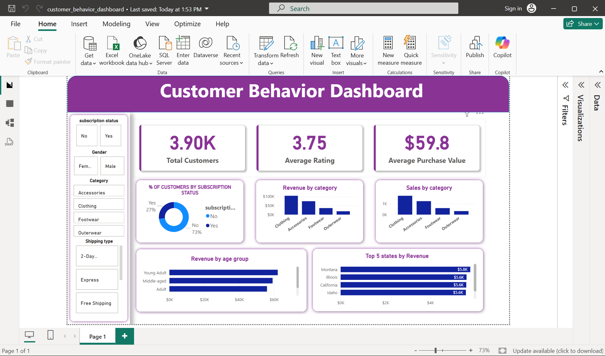

# Customer Behavior Analytics Dashboard

An interactive **Power BI dashboard** designed to analyze customer purchasing behavior, revenue patterns, subscription adoption, product-category performance, age-group spending, and geographic revenue distribution.

## Project Overview

The Customer Behavior Analytics Dashboard transforms customer transaction data into an interactive business intelligence report. It provides a high-level view of customer activity while allowing users to drill into purchasing patterns through interactive filters.

The dashboard was built to answer questions such as:

- How many customers are represented in the dataset?
- What is the average customer rating?
- What is the average purchase value?
- Which product categories generate the most revenue?
- Which categories receive the highest number of orders?
- Which age groups contribute the most revenue?
- Which states generate the highest revenue?
- What proportion of customers are subscribed?

## Dashboard Preview




## Key Features

### KPI Overview
- Total Customers
- Average Rating
- Average Purchase Value
- 
### Customer Segmentation
Interactive slicers allow analysis by:
- Subscription Status
- Gender
- Product Category
- Shipping Type

### Revenue & Sales Analysis
The dashboard includes:
- Revenue by Product Category
- Sales by Product Category
- Revenue by Age Group
- Top 5 States by Revenue

### Top-N Analysis
The geographic analysis uses a dynamic **Top 5** filter so the highest-revenue states can be identified based on the current filter context.

## Data & Tools

| Component | Technology |
|---|---|
| Data Source | MySQL |
| Database | MySQL |
| BI Tool | Microsoft Power BI |
| Querying | SQL |
| Data Visualization | Power BI |
| Analysis | Customer segmentation, aggregation, ranking and Top-N analysis |

## SQL Analysis

SQL was used to explore and prepare the underlying customer behavior data.

Example: revenue comparison by gender:

```sql
SELECT
    gender,
    SUM(purchase_amount) AS revenue
FROM customer_behavior
GROUP BY gender;
```

Example: Top 3 purchased items within each category:

```sql
WITH item_counts AS (
    SELECT
        category,
        item_purchased,
        COUNT(customer_id) AS total_orders,
        ROW_NUMBER() OVER (
            PARTITION BY category
            ORDER BY COUNT(customer_id) DESC
        ) AS item_rank
    FROM customer_behavior
    GROUP BY category, item_purchased
)
SELECT
    item_rank,
    category,
    item_purchased,
    total_orders
FROM item_counts
WHERE item_rank <= 3;
```

## Business Insights

The dashboard is designed to highlight:

1. **Category performance** – identify the categories contributing most to revenue and orders.
2. **Customer engagement** – understand subscription adoption and customer segmentation.
3. **Customer value** – monitor average purchase value.
4. **Demographic behavior** – compare revenue contribution across age groups.
5. **Geographic performance** – identify the top-performing states by revenue.

## Dashboard Design

The dashboard follows a simple business intelligence layout:

1. Header and dashboard title
2. Interactive filters
3. KPI cards
4. Category analysis
5. Demographic analysis
6. Geographic Top-5 analysis

The design emphasizes clear labels, data labels, consistent spacing, and interactive filtering.

## How to Use

1. Open the `.pbix` file in **Power BI Desktop**.
2. Refresh the data connection if required.
3. Use the slicers to filter the dashboard.
4. Select a category, gender, subscription status, or shipping type to update the visuals.
5. Hover over charts to view additional values.

## Repository Structure

```text
customer-behavior-analytics/
│
├── README.md
├── Customer_Behavior_Analytics.pbix
├── dashboard.png
├── Customer_Behavior_Analytics_Report.pdf
└── sql/
    ├── revenue_analysis.sql
    └── top_items_analysis.sql
```

## Future Improvements

- Add Total Revenue and Subscription Rate as KPI cards.
- Add month-over-month or year-over-year trends if transaction dates are available.
- Add customer lifetime value analysis.
- Add a dedicated customer segmentation page.
- Add a geographic map for state-level performance.
- Add automated refresh through Power BI Service.
- Add drill-through pages for category and customer-level analysis.

## Author

**Vishal Deep**
---
### Project Type
**Business Intelligence | Data Analytics | Power BI | SQL | Customer Analytics**
